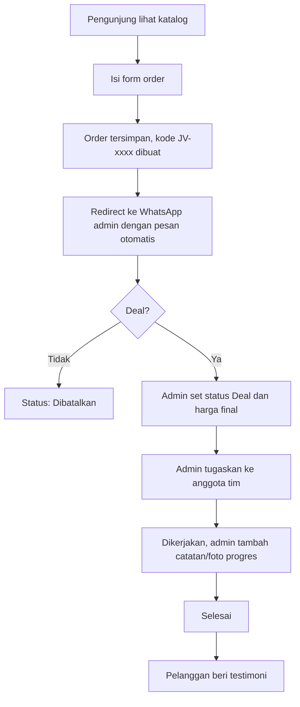

# JoyVer: Project Brief

> Dokumen acuan utama proyek. Semua keputusan desain dan pengembangan merujuk ke sini.
> Perbarui dokumen ini setiap ada keputusan baru.

Status: **Perencanaan** | Terakhir diperbarui: 2026-11-20

---

## 1. Ringkasan Proyek

**JoyVer** (Joy + Clover) adalah website katalog jasa kreatif. Pengunjung melihat layanan, mengisi form order, lalu diarahkan ke WhatsApp untuk berdiskusi sampai deal. Setelah deal, pelanggan bisa melacak progres pesanan di web.

- **Tagline:** We Create Joy
- **Nilai brand:** Cultivate relationship, and invite good fortune to grow.
- **Sub-tagline hero (usulan):** "Undangan digital, website usaha, dan buket bunga yang dibuat dengan sepenuh hati."

## 2. Model Bisnis

- Katalog jasa dengan harga yang bisa diatur dan diubah admin.
- Harga ditampilkan sebagai **"mulai dari Rp X"** (tanpa paket Basic/Standar/Premium).
- Negosiasi dan kesepakatan final dilakukan di **WhatsApp**.
- Satu nomor WhatsApp admin untuk semua order.

### Layanan awal
1. Website undangan digital
2. Website usaha
3. Buket bunga
4. Kategori lain bisa ditambah lewat dashboard admin, tanpa mengubah kode.

## 3. Target Pengguna dan Peran

Target pelanggan: **mahasiswa** dan **masyarakat umum**.

| Peran | Login | Kemampuan |
|---|---|---|
| Pengunjung/Pelanggan | Tidak | Lihat katalog dan tim, isi form order, lacak order dengan kode order + nomor WA, kirim testimoni |
| Admin | Ya | Kelola layanan, harga, profil tim, order, status, penugasan, progres, dan moderasi testimoni |
| Anggota tim | Tidak (MVP) | Tampil di halaman "Tim" (nama, foto, keahlian). Login tim menyusul di versi 2 |

**Penugasan:** setiap anggota tim punya tag keahlian (mis. Web, Desain, Floral). Admin menugaskan order ke anggota yang sesuai.

## 4. Alur Utama

**Status order:** Menunggu konfirmasi, Deal, Dikerjakan, Selesai, Dibatalkan.

## 5. Ruang Lingkup MVP

| Fitur | Prioritas | Catatan |
|---|---|---|
| Katalog layanan | Wajib | Kategori, deskripsi, foto, harga "mulai dari" |
| Halaman tim | Wajib | Nama, foto, keahlian |
| Form order + redirect WA | Wajib | Simpan data, lalu buka `wa.me` dengan pesan terisi |
| Tracking order | Wajib | Input kode order + nomor WA |
| Dashboard admin | Wajib | CRUD layanan, kategori, tim, order, testimoni |
| Testimoni dan rating | Wajib | Tampil setelah disetujui admin |
| Bukti progres | Sederhana | Admin unggah foto/tautan preview + catatan per order |
| Notifikasi | Bertahap | MVP: email ke admin saat ada order baru |
| Halaman legal | Wajib | Syarat & Ketentuan, Kebijakan Privasi sederhana |

### Di luar MVP (versi 2)
- Notifikasi WhatsApp otomatis ke pelanggan (API resmi, berbayar)
- Login anggota tim dan dashboard tim
- Chat di web (diganti WhatsApp)
- Payment gateway

## 6. Batasan dan Kebijakan

- **Legal/etika:** web hanya menampilkan jasa yang legal. Layanan sensitif (mis. joki) ditangani privat lewat WA dan tidak disimpan di sistem.
- **Data pribadi:** simpan seperlunya (nama, nomor WA, kebutuhan order). Jangan simpan kredensial akun atau data sensitif.
- **Skala:** kecil di awal, tanpa infrastruktur rumit.
- **Waktu:** tidak ada tenggat. Prioritasnya selesai dengan baik.
- **Pembayaran:** diatur manual di luar sistem (via WA).

## 7. Teknologi

| Lapisan | Pilihan |
|---|---|
| Framework | Next.js (React) |
| Styling | Tailwind CSS |
| Database, Auth admin, Storage foto | Supabase |
| Hosting | Vercel |

## 8. Desain dan Brand

**Gaya:** "Fresh Garden, Warm Craft": segar, hangat, rapi, dan dipercaya.

### Palet warna
| Nama | Hex | Pemakaian |
|---|---|---|
| Deep Green | `#0B6B3A` | Navbar, judul, tombol utama, footer |
| Clover Green | `#4CAF50` | Hover, badge, ikon, aksen sekunder |
| Golden Yellow | `#FFC83D` | Tombol CTA utama (teks hijau tua), bintang rating |
| Off White | `#FAF9F6` | Latar halaman |

Aturan: dominan off white, hijau tua untuk struktur, kuning hanya untuk aksi utama. Jangan memakai teks kuning di atas latar putih.

### Tipografi
- Judul: Poppins atau Fraunces
- Isi: Inter atau Plus Jakarta Sans

### Elemen visual
- Sudut membulat besar (16-24px), bayangan lembut
- Motif daun semanggi tipis sebagai dekorasi/pemisah
- Foto hasil karya berukuran besar
- Animasi halus (fade-in, hover naik sedikit)
- Mobile-first

## 9. Struktur Halaman

**Publik**
1. Beranda: hero, kategori jasa, cara pesan (3 langkah), testimoni, CTA
2. Layanan: katalog dan detail, form order
3. Tim
4. Lacak Pesanan
5. Tentang, Syarat & Ketentuan, Kebijakan Privasi

**Admin** (`/admin`, wajib login)
1. Ringkasan order
2. Order (daftar, detail, ubah status, tugaskan, progres)
3. Layanan dan kategori
4. Tim
5. Testimoni (moderasi)

## 10. Rancangan Database (awal)

| Tabel | Kolom utama |
|---|---|
| `categories` | id, name, slug, sort_order |
| `services` | id, category_id, name, slug, description, price_from, image_url, is_active |
| `team_members` | id, name, photo_url, bio, skills (array), is_active |
| `orders` | id, code (JV-xxxx), customer_name, customer_wa, service_id, details, status, final_price, assigned_to (team_member_id), created_at |
| `order_updates` | id, order_id, note, image_url, created_at |
| `testimonials` | id, order_id (opsional), name, rating (1-5), message, is_approved, created_at |

**Keamanan:** aktifkan Row Level Security di Supabase. Publik hanya bisa membaca data aktif/disetujui dan membuat order. Tracking membutuhkan kode order + nomor WA. Semua pengelolaan hanya untuk admin.

## 11. Keputusan Terkunci

- [x] Stack: Next.js + Tailwind + Supabase + Vercel
- [x] Satu nomor WA admin untuk semua order
- [x] Harga "mulai dari Rp X"
- [x] Warna sesuai logo, gaya "Fresh Garden, Warm Craft"
- [x] Pelanggan dan tim tanpa akun di MVP
- [x] Diskusi dan deal lewat WhatsApp, tanpa chat di web

## 12. Hal Terbuka

- [ ] File logo (sementara placeholder)
- [ ] Nomor WhatsApp admin (sementara placeholder)
- [ ] Pilihan font final
- [ ] Konten awal: deskripsi layanan, foto contoh, data tim
- [ ] Domain website

## 13. Rencana Kerja

1. [x] Finalisasi skema database (SQL Supabase + RLS): `supabase/migrations/0001_init.sql`, `supabase/seed.sql`
2. [x] Inisialisasi proyek Next.js + Tailwind, tema warna dan font (Fraunces + Plus Jakarta Sans)
3. [x] Halaman publik: beranda, katalog, tim, form order + redirect WA (halaman `/lacak` masih placeholder, dikerjakan di langkah 4)
4. [ ] Tracking order dan testimoni
5. [ ] Dashboard admin (CRUD + progres)
6. [ ] Notifikasi email ke admin
7. [ ] Halaman legal, pengujian, deploy ke Vercel
